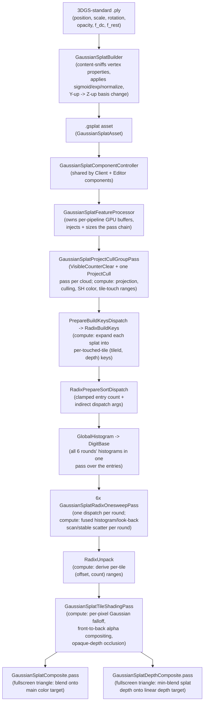

# GaussianSplat Gem for Open 3D Engine (O3DE)

A gem for O3DE that renders [3D Gaussian Splatting](https://repo-sam.inria.fr/fungraph/3d-gaussian-splatting/) scenes. Each splat is a 3D Gaussian defined by a position, anisotropic scale + rotation (covariance), opacity, and a view-dependent color encoded as spherical-harmonics (SH) coefficients. Splats are imported from 3DGS-standard `.ply` files and rendered through a tile-based compute rasterizer.

## A bit of context

- [Open 3D Engine](https://o3de.org) - an open-source game & simulation engine. O3DE is extendable through modules called Gems. This is one such Gem.
- [3D Gaussian Splatting](https://repo-sam.inria.fr/fungraph/3d-gaussian-splatting/) - rasterization-based technique used in the field of real-time radiance fields for representing and rendering photorealistic three-dimensional scenes from a sparse set of two-dimensional images.

## Requirements

The gem targets Linux with the Vulkan RHI only, and has not been tested on any other platform. Other platforms are disabled: their CMake returns early and builds no targets. Supporting them should be possible, but may take some work.

SM6.0 **wave intrinsics** (`RHI::DeviceFeatures::m_waveOperation`), guaranteed by the Vulkan 1.1 target the shaders set. There is no non-wave fallback path - see [`Docs/Rasterizer.md`](./Docs/Rasterizer.md)'s "Wave intrinsics are a hard requirement".

The gem was tested with O3DE 2605.0 and 2610.0.

## Examples

Below are some examples of scenes rendered with GaussianSplat gem in O3DE:

| Screenshot                                                       | Attribution                                                                                                                                                                                                 |
| ---------------------------------------------------------------- | ----------------------------------------------------------------------------------------------------------------------------------------------------------------------------------------------------------- |
|            | ["Cluster Fly"](https://superspl.at/scene/285082b2) by [danylyon](https://superspl.at/user/danylyon), licensed under [CC BY 4.0](https://creativecommons.org/licenses/by/4.0/).                             |
|  | ["Winter Garden"](https://superspl.at/scene/7a475d38) by [andriishramko](https://superspl.at/user/andriishramko), licensed under [CC BY 4.0](https://creativecommons.org/licenses/by/4.0/).                 |
|  | ["International Space Station - Synthetic scene"](https://superspl.at/scene/cc026f6a) by [tmate](https://superspl.at/user/tmate), licensed under [CC BY 4.0](https://creativecommons.org/licenses/by/4.0/). |

## Usage

1. Place a Gaussian Splat `.ply` file inside the project's Assets folder.
2. Create an entity with a `Gaussian Splat` Component.  
   
3. Select Gaussian Splat asset in the selector.  
   
4. Adjust parameters to suit your needs.  
   

## Runtime tunables (`GaussianSplatComponentConfig`)

| Editor field           | Purpose                                                                                                                                                                           |
| ---------------------- | --------------------------------------------------------------------------------------------------------------------------------------------------------------------------------- |
| `Gaussian Splat Asset` | The `.gsplat` asset reference to render                                                                                                                                           |
| `Opacity Multiplier`   | Global alpha multiplier applied on top of each splat's stored opacity; `[0, 1]`, so it can only attenuate                                                                         |
| `Scale Multiplier`     | Global size multiplier applied on top of each splat's stored scale; `[0, 10]`. Resizes each splat in place, unlike the entity Transform's scale, which also changes splat spacing |
| `Max SH Degree`        | Clamps SH evaluation below what the asset stores - `0` renders flat (DC-only) color, useful as a quality/perf knob. Also shrinks the GPU SH buffer                                |

## Global Configuration

### Radix-sort entry capacity

The radix-sort entry buffers are sized to a fixed capacity, set once when the feature processor activates, from the **Settings Registry key** `/Robotec/GaussianSplat/RadixEntryCapacity` (default `16 * 1024 * 1024`), defaulted in [`Registry/gaussiansplat_settings.setreg`](./Registry/gaussiansplat_settings.setreg).

A value of `0` is treated as invalid and falls back to the compiled-in default. The capacity drives the two largest allocations in the gem: at the default, each of the two ping-pong entry buffers is ~192 MB. If those allocations fail, the pass chain is left out - and retried the next frame - rather than taking the pipeline down; lower this value if the splats never appear.

### Depth output

The splats' own depth is merged into the render pipeline's linear depth buffer (`DepthPrePass`'s `DepthLinear`) by a composite pass, the depth-side counterpart of the color composite. The key below is read once at activation, from [`Registry/gaussiansplat_settings.setreg`](./Registry/gaussiansplat_settings.setreg):

- `/Robotec/GaussianSplat/DepthCoverageThreshold` (default `0.02`) selects _which_ splat a pixel's depth comes from - the first one, front to back, whose compositing pushes the pixel's accumulated coverage to this value. Near `0` this is the nearest splat that contributes at all; `0.5` gives the median depth. Values outside `(0, 1]` fall back to the default.

Because the splat pass chain runs after `PostProcessPass`, the merged depth is visible to consumers placed after the chain (addressable as `GaussianSplatParent`'s `DepthLinearInputOutput`), not to the engine's own post-processing, which reads depth earlier in the frame. See `Docs/Rasterizer.md`'s "Depth output".

## Data flow

The pipeline is GPU-only from end to end: per-splat screen-space projection, culling and SH color evaluation run in a compute pass, then a chain of compute passes expands each splat into per-tile entries and radix-sorts them by a combined `(tileIndex, depth)` key, before a tile-shading compute pass composites each tile's sorted splats front-to-back. The sort is a six-round, 8-bit LSD **Onesweep** radix sort with decoupled look-back, written from scratch for O3DE.

See [`Docs/Architecture.md`](./Docs/Architecture.md) for the design-decision record (asset format, coordinate conversion, GPU buffer layout),
[`Docs/Rasterizer.md`](./Docs/Rasterizer.md) for the rendering pipeline specifically.

## Known limitations

- Very dense views can drop splats once a frame outgrows the radix-sort entry capacity. If splats vanish up close, raise `/Robotec/GaussianSplat/RadixEntryCapacity` (see [Radix-sort entry capacity](#radix-sort-entry-capacity)).
- Render outputs above ~16.7 megapixels (65535 16x16-pixel tiles, e.g. beyond roughly 5460x3070) are not supported - splats sort incorrectly and a warning is logged.
- Resizing a viewport or loading a cloud causes a brief hitch while the GPU buffers are rebuilt.
- Only the 3DGS-standard `.ply` layout is imported - there is no `.splat` (antimatter15 compact format) import path.

See [`Docs/Rasterizer.md`](./Docs/Rasterizer.md)'s "Known open risks" for implementation-level caveats.

## License

This gem is licensed under the [Apache License, Version 2.0](./LICENSE.txt) (`SPDX-License-Identifier: Apache-2.0`).

The example screenshots in [`Docs/Images`](./Docs/Images) and [`preview.png`](./preview.png) (a copy of the "Cluster Fly" screenshot) are renders of third-party scenes, adapted under the licenses listed in [Examples](#examples). They are not covered by the gem's license.
